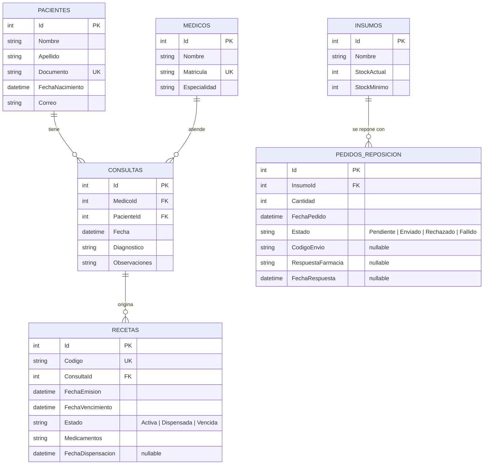

# MediLink — API REST Hospital

API REST para administrar pacientes, médicos, consultas y recetas electrónicas. Se integra con la API de la farmacia (PharmaLink) para notificar y validar recetas, dispensar medicamentos y solicitar reposición de insumos médicos.

**Tecnologías:** .NET 10 (ASP.NET Core, controllers), Entity Framework Core, SQLite, OpenAPI + Swagger UI.

## Estructura del repositorio

| Proyecto | Descripción |
|---|---|
| `MediLink/` | API del hospital (puerto `5144`) |
| `FarmaciaMock/` | Simulador de la API de la farmacia (puerto `5050`) |

## Cómo ejecutarlo

1. Instalar el SDK de .NET 10.
2. Crear la base de datos (si `medilink.db` no existe):
   ```bash
   cd MediLink
   dotnet ef database update
   ```
3. Levantar la farmacia simulada:
   ```bash
   cd FarmaciaMock
   dotnet run
   ```
4. Levantar la API del hospital:
   ```bash
   cd MediLink
   dotnet run
   ```
5. Documentación interactiva (Swagger UI): `http://localhost:5144/swagger`

### Configuración (`MediLink/appsettings.json`)

```json
{
  "ApiKey": "compilaDeMilagro123",
  "PharmaLink": {
    "BaseUrl": "http://localhost:5050",
    "ApiKey": "MediLink-Secret-Key-2026"
  }
}
```

- `ApiKey`: clave que deben enviar los clientes para los endpoints protegidos.
- `PharmaLink`: URL base y clave que MediLink usa para llamar a la farmacia.

## Autenticación

Los endpoints marcados con (se necesita autenticacion) requieren la cabecera:

```
X-API-Key: <clave>
```

Sin cabecera o con una clave inválida se responde `401 Unauthorized`.

## Formato de respuesta

Todas las respuestas son JSON con la misma estructura:

```json
{
  "success": true,
  "message": "Mensaje claro sobre el resultado.",
  "data": { }
}
```

Errores de validación (`400`):

```json
{
  "success": false,
  "message": "Datos inválidos.",
  "data": {
    "Correo": ["El correo electrónico no tiene un formato válido."]
  }
}
```

### Códigos HTTP utilizados

| Código | Significado |
|---|---|
| 200 | Operación exitosa |
| 201 | Recurso creado |
| 400 | Datos inválidos o regla de negocio incumplida |
| 401 | API Key ausente o inválida |
| 404 | Recurso inexistente |
| 409 | Conflicto (duplicado o estado no permitido) |
| 500 | Error interno |
| 503 | Farmacia no disponible |

## Modelo de base de datos



Restricciones únicas: `Pacientes.Documento`, `Medicos.Matricula`, `Recetas.Codigo`.
Las migraciones están en `MediLink/Migrations`.

## Endpoints

### Pacientes

| Método | URL | Descripción |
|---|---|---|
| POST | `/api/pacientes` | Registra un paciente |
| GET | `/api/pacientes` | Lista los pacientes |
| GET | `/api/pacientes/{id}` | Obtiene un paciente por id |

**POST /api/pacientes**

```json
{
  "nombre": "Ana",
  "apellido": "Pérez",
  "documento": "12345678",
  "fechaNacimiento": "1990-05-14",
  "correo": "ana@mail.com"
}
```

Respuesta `201`:

```json
{
  "success": true,
  "message": "Paciente registrado correctamente.",
  "data": {
    "id": 1,
    "nombre": "Ana",
    "apellido": "Pérez",
    "documento": "12345678",
    "fechaNacimiento": "1990-05-14T00:00:00",
    "correo": "ana@mail.com"
  }
}
```

Otras respuestas: `400` datos inválidos · `409` "Ya existe un paciente con ese documento." · `404` en GET por id inexistente.

### Médicos

| Método | URL | Descripción |
|---|---|---|
| POST | `/api/medicos` | Registra un médico |
| GET | `/api/medicos` | Lista los médicos |
| GET | `/api/medicos/{id}` | Obtiene un médico por id |

**POST /api/medicos**

```json
{
  "nombre": "Dr. Juan Gómez",
  "matricula": "MP-4521",
  "especialidad": "Cardiología"
}
```

Respuesta `201`:

```json
{
  "success": true,
  "message": "Médico registrado correctamente.",
  "data": { "id": 1, "nombre": "Dr. Juan Gómez", "matricula": "MP-4521", "especialidad": "Cardiología" }
}
```

Otras respuestas: `400` · `409` "Ya existe un médico con esa matrícula." · `404`.

### Consultas

| Método | URL | Descripción |
|---|---|---|
| POST | `/api/consultas` | Registra una consulta |
| GET | `/api/consultas` | Lista las consultas |
| GET | `/api/consultas/{id}` | Obtiene una consulta por id |

**POST /api/consultas** (si no se envía `fecha`, se usa la actual)

```json
{
  "medicoId": 1,
  "pacienteId": 1,
  "fecha": "2026-11-18T10:30:00",
  "diagnostico": "Hipertensión leve",
  "observaciones": "Control en 30 días"
}
```

Respuesta `201`:

```json
{
  "success": true,
  "message": "Consulta registrada correctamente.",
  "data": {
    "id": 1,
    "medicoId": 1,
    "medico": "Dr. Juan Gómez",
    "pacienteId": 1,
    "paciente": "Ana Pérez",
    "fecha": "2026-11-18T10:30:00",
    "diagnostico": "Hipertensión leve",
    "observaciones": "Control en 30 días"
  }
}
```

Otras respuestas: `400` si el médico o el paciente no existen · `404` en GET por id inexistente.

### Recetas

| Método | URL | Auth | Descripción |
|---|---|---|---|
| POST | `/api/consultas/{consultaId}/recetas` | (se necesita autenticacion) | Emite una receta desde una consulta|
| GET | `/api/recetas/{codigo}` | | Consulta el estado de una receta |

**POST /api/consultas/1/recetas**

```json
{
  "medicamentos": "Enalapril 10mg cada 12 hs",
  "diasValidez": 30
}
```

`diasValidez` es opcional (por defecto 30, entre 1 y 365). El código, las fechas y el estado los genera el servidor.

Respuesta `201`:

```json
{
  "success": true,
  "message": "Receta emitida y notificada a la farmacia.",
  "data": {
    "receta": {
      "codigo": "RX-1A2B3C4D",
      "consultaId": 1,
      "paciente": "Ana Pérez",
      "medico": "Dr. Juan Gómez",
      "medicamentos": "Enalapril 10mg cada 12 hs",
      "fechaEmision": "2026-11-18T13:40:00Z",
      "fechaVencimiento": "2026-12-18T13:40:00Z",
      "estado": "Activa",
      "fechaDispensacion": null
    },
    "farmaciaNotificada": true
  }
}
```

Si la farmacia no responde, la receta igual se emite, `farmaciaNotificada` es `false` y el mensaje lo indica.
Otras respuestas: `400` datos inválidos · `401` sin API Key · `404` si la consulta no existe.

**GET /api/recetas/RX-1A2B3C4D** → `200` con los datos de la receta (si estaba Activa y ya venció, se actualiza a `Vencida`) o `404`.

### Integración con farmacia

| Método | URL | Auth | Descripción |
|---|---|---|---|
| POST | `/api/farmacia/recetas/{codigo}/validar` | (se necesita autenticacion) | La farmacia valida una receta antes de dispensar |
| POST | `/api/farmacia/recetas/{codigo}/dispensar` | (se necesita autenticacion) | La farmacia confirma la dispensación |

**POST /api/farmacia/recetas/RX-1A2B3C4D/validar** → `200`:

```json
{
  "success": true,
  "message": "Receta válida para dispensar.",
  "data": {
    "codigo": "RX-1A2B3C4D",
    "medicamentos": "Enalapril 10mg cada 12 hs",
    "estado": "Activa"
  }
}
```

Otras respuestas: `400` si ya fue dispensada o está vencida · `401` · `404` si no existe.

**POST /api/farmacia/recetas/RX-1A2B3C4D/dispensar** → `200`:

```json
{
  "success": true,
  "message": "Receta dispensada exitosamente.",
  "data": { "codigo": "RX-1A2B3C4D", "fechaDispensacion": "2026-11-19T09:15:00Z" }
}
```

Otras respuestas: `409` si ya fue dispensada o está vencida · `401` · `404`.

### Insumos

| Método | URL | Descripción |
|---|---|---|
| POST | `/api/insumos` | Da de alta un insumo |
| GET | `/api/insumos` | Lista los insumos |
| GET | `/api/insumos/stock-bajo` | Insumos con stock actual ≤ mínimo |
| GET | `/api/insumos/{id}` | Obtiene un insumo por id |
| PUT | `/api/insumos/{id}/stock` | Actualiza el stock actual |

**POST /api/insumos**

```json
{ "nombre": "Guantes de látex", "stockActual": 5, "stockMinimo": 20 }
```

Respuesta `201`:

```json
{
  "success": true,
  "message": "Insumo creado correctamente.",
  "data": { "id": 1, "nombre": "Guantes de látex", "stockActual": 5, "stockMinimo": 20 }
}
```

Otras respuestas: `400` datos inválidos · `409` insumo duplicado (por nombre) · `404` en GET/PUT por id inexistente.

**PUT /api/insumos/1/stock**

```json
{ "stockActual": 3 }
```

### Reposición de insumos

| Método | URL | Auth | Descripción |
|---|---|---|---|
| POST | `/api/reposiciones` | (se necesita autenticacion) | Crea un pedido y lo envía a la farmacia |
| GET | `/api/reposiciones` | (se necesita autenticacion) | Lista los pedidos |
| GET | `/api/reposiciones/{id}` | (se necesita autenticacion) | Obtiene un pedido por id |

**POST /api/reposiciones**

```json
{ "insumoId": 1, "cantidad": 50 }
```

Respuesta `201` (farmacia confirma):

```json
{
  "success": true,
  "message": "Pedido de reposición enviado a la farmacia.",
  "data": {
    "id": 1,
    "insumoId": 1,
    "nombreInsumo": "Guantes de látex",
    "cantidad": 50,
    "fechaPedido": "2026-11-18T14:00:00Z",
    "estado": "Enviado",
    "codigoEnvio": "ENV-9F3A21BC",
    "respuestaFarmacia": "Solicitud procesada y despacho programado.",
    "fechaRespuesta": "2026-11-18T14:00:01Z"
  }
}
```

Estados posibles de un pedido:

| Estado | Significado | HTTP |
|---|---|---|
| `Pendiente` | Registrado, a la espera de la respuesta | — |
| `Enviado` | La farmacia confirmó el envío | 201 |
| `Rechazado` | La farmacia lo rechazó (el pedido queda registrado) | 201 |
| `Fallido` | La farmacia no respondió (caída o timeout de 10 s) | 503 |

Otras respuestas: `400` cantidad inválida · `401` sin API Key · `404` insumo inexistente.

### Vista consolidada de pedidos (desafío adicional)

| Método | URL | Descripción |
|---|---|---|
| GET | `/api/vista/pedidos` | Todos los pedidos de reposición con su insumo, estado y respuesta de la farmacia, del más reciente al más antiguo |

Respuesta `200`:

```json
{
  "success": true,
  "message": "Se encontraron 2 pedidos de reposición.",
  "data": [
    {
      "id": 2,
      "insumoId": 1,
      "nombreInsumo": "Guantes de látex",
      "cantidad": 2000,
      "fechaPedido": "2026-11-18T14:05:00Z",
      "estado": "Rechazado",
      "codigoEnvio": null,
      "respuestaFarmacia": "Cantidad superior al stock disponible en la farmacia.",
      "fechaRespuesta": "2026-11-18T14:05:01Z"
    },
    {
      "id": 1,
      "insumoId": 1,
      "nombreInsumo": "Guantes de látex",
      "cantidad": 50,
      "fechaPedido": "2026-11-18T14:00:00Z",
      "estado": "Enviado",
      "codigoEnvio": "ENV-9F3A21BC",
      "respuestaFarmacia": "Solicitud procesada y despacho programado.",
      "fechaRespuesta": "2026-11-18T14:00:01Z"
    }
  ]
}
```

## Contrato con la farmacia (PharmaLink)

Cabecera en todas las llamadas: `X-API-Key`.

| Llamada de MediLink | Body enviado | Respuesta esperada |
|---|---|---|
| `POST {PharmaLink}/api/recetas/notificar` | `{ "codigo", "medicamentos", "fechaEmision" }` | `200 OK` |
| `POST {PharmaLink}/api/reposiciones` | `{ "insumo", "cantidad" }` | `{ "confirmado", "codigoEnvio", "mensaje" }` |

## Pruebas

- `MediLink/MediLink.http`: peticiones de ejemplo de insumos y reposiciones.
- `FarmaciaMock` rechaza pedidos de más de 1000 unidades, para probar el estado `Rechazado`. Si se apaga, se prueba el estado `Fallido`.